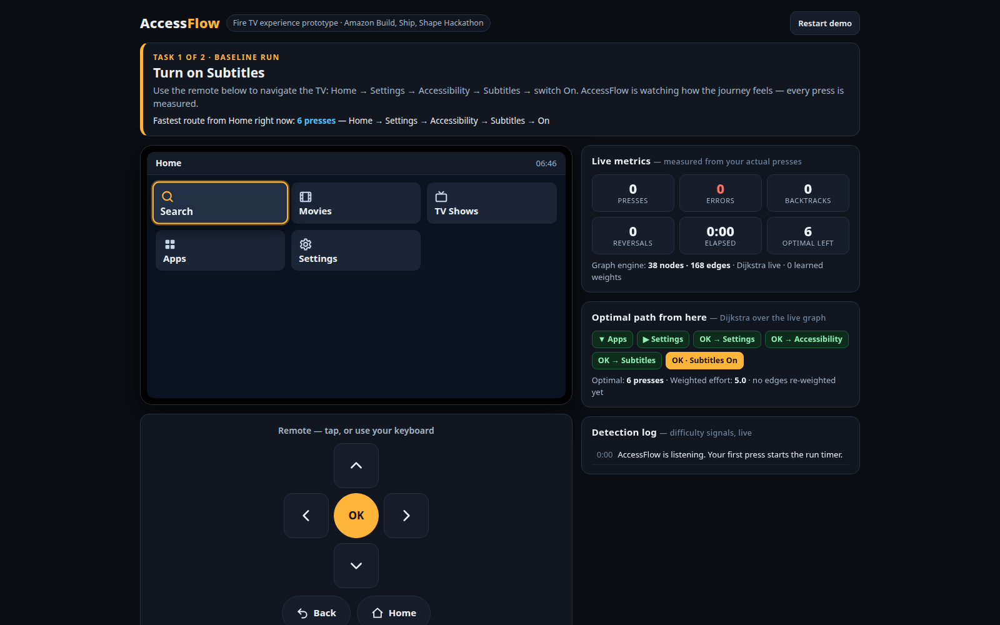
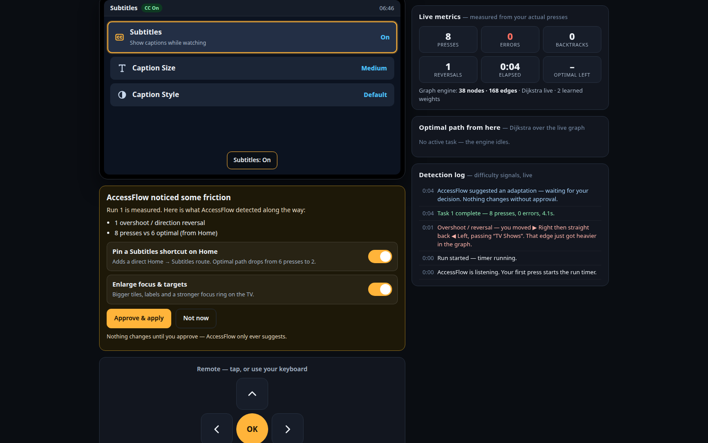
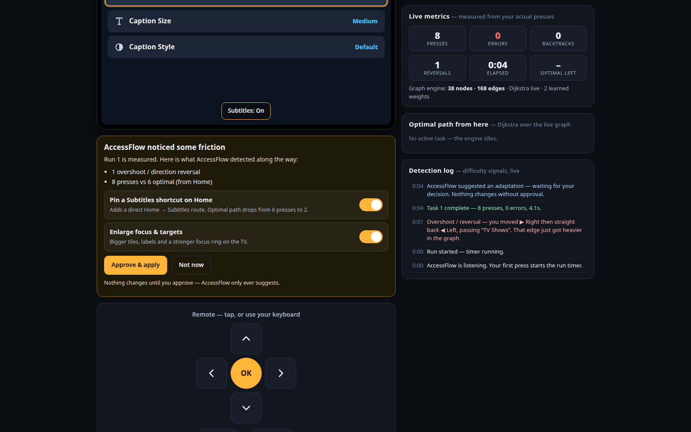
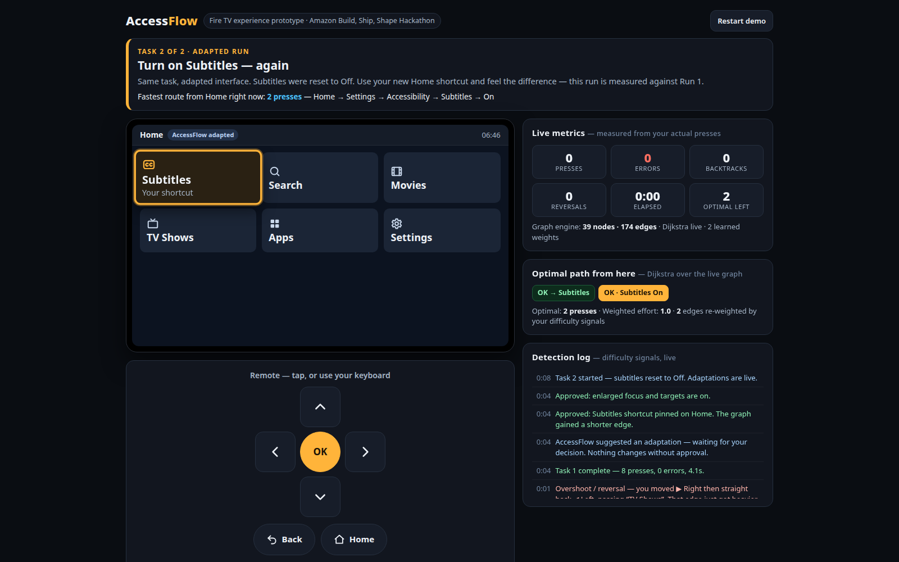
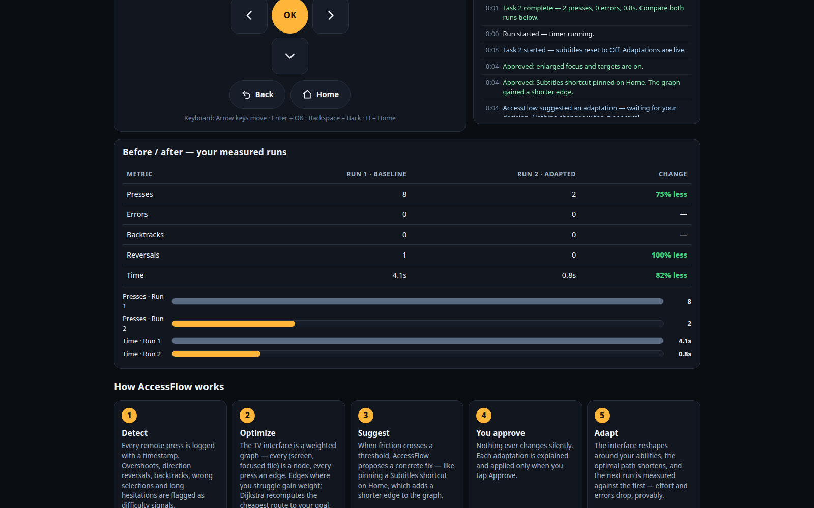
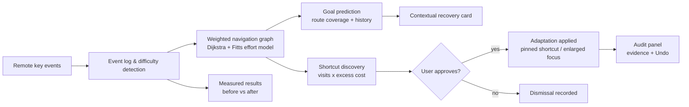

# AccessFlow: AI-Powered Adaptive Navigation for Smart TV Accessibility

[](https://github.com/arya123-sudo/AccessFlow/actions/workflows/ci.yml)

An AI-assisted, self-adaptive navigation system for Amazon Fire TV that personalizes navigation based on individual user needs and interaction patterns — built for the **Build, Ship, Shape: Amazon Developer Hackathon** (Fire TV track).

## The problem
Smart TV applications require complex menu navigation and repeated remote-control interactions, creating accessibility challenges for users with motor impairments and navigation difficulties. Existing interfaces do not adapt to individual interaction patterns, resulting in increased effort, navigation errors, and difficulty completing tasks.

## The solution
AccessFlow identifies navigation difficulties, dynamically optimizes interaction paths using **weighted graph algorithms**, and provides **contextual task recovery**. It continuously adapts to **user-approved** preferences to reduce navigation effort, minimize errors, and make the smart TV experience more intuitive and personalized.

## Key innovation
A self-adapting, ability-aware navigation engine that learns from interaction difficulties and optimizes TV navigation workflows, instead of relying on fixed navigation structures.

## Screenshots
Real captures from an actual run of the prototype (see `docs/DEMO_GUIDE.md` for the flow):

**Fire TV Home — baseline navigation**


**Task 1 done — difficulty detected and logged live (overshoots, reversals, presses vs optimal)**


**AccessFlow proposes an adaptation — with its evidence, and only the user can approve it**


**Home after approval — the Subtitles shortcut is pinned**


**Measured results — baseline vs adapted run, computed from the actual runs**


## How it works
1. **Detect** — every remote press is logged; overshoots, backtracks, wrong selects, reversals, and hesitations are classified live.
2. **Optimize** — screens and focus positions are graph nodes, remote actions are weighted edges; Dijkstra's algorithm computes the lowest-effort path to the goal. Edge costs use a Fitts's-law effort model — `(1 + log₂(distance ÷ target size + 1)) × (1 + your error rate)` plus a learned bump on edges where you struggled — so "effort" reflects target size, distance, and your own error pattern, not just press counts.
3. **Discover & suggest** — after each run, destinations are ranked by `visits × average excess cost` from your measured statistics, and a shortcut to the *winning* destination is proposed with its evidence. Nothing is pre-chosen: costly, frequent destinations surface on their own. Enlarged focus is proposed separately when overshoots/reversals are high.
4. **Approve** — nothing changes without the user's explicit approval.
5. **Adapt, audit & undo** — applied adaptations are recorded in an audit panel with their triggering evidence and a timestamp, and each can be **undone** (the shortcut tile, graph edge, and size mode all revert). Dismissed suggestions are recorded too.
6. **Recover** — mid-task difficulty triggers a recovery card whose goal is *predicted* from your path so far (route-coverage matching against each destination's canonical route, blended with learned prefix counts and visit history) with the next Dijkstra step to that goal. This is transparent counting over the graph — **not an LLM**, and it is labelled that way in the UI.
7. **Movement profile** — a preference *you* set (Standard / **Reduce horizontal effort** / **Reduce vertical effort**), never an auto-adaptation: moves in the direction you find harder cost ×2.0 in the weighted effort model, so effort-based routing (the weighted-effort figure, the recovery card's next step) steers around that axis. Press counts and optimal-press figures never change — only weighted cost does. Set it any time from the Live metrics panel; changes are logged as preferences, not adaptations.

### Architecture at a glance


## Tests
```
node --test        # node:test suite in tests/ — Dijkstra, Fitts monotonicity,
                   # discovery ranking, goal prediction, detection helper
node --check js/engine.js && node --check js/app.js
```
CI (GitHub Actions, workflow `ci`) runs the same checks on every push.

## Demo
- **Demo video (v2, 2:20):** https://youtu.be/4bUqTW4MOoA — detection, recovery prediction, shortcut discovery, audit & undo, and the measured 8 → 2 press improvement.
- **Live prototype:** https://arya123-sudo.github.io/AccessFlow/ — a mobile-first Fire TV experience simulator (10-foot UI + tappable on-screen remote).
- Task flow: Home → Settings → Accessibility → Subtitles → On, first unadapted, then adapted.
- Full walkthrough for judges: [docs/DEMO_GUIDE.md](docs/DEMO_GUIDE.md)

## Fire TV app
The same engine ships as a native Fire OS app — a thin WebView shell (package `com.arya.accessflow`) bundling this exact web build, driven by real Fire TV remote key events. Source: [`fire-tv/`](fire-tv/) · Build & sideload guide: [docs/INSTALL_FIRE_TV.md](docs/INSTALL_FIRE_TV.md) (includes honest status notes on device-farm verification).

## User study
A structured study protocol (3 tasks, no staged errors, standard SUS questionnaire, non-dominant-hand runs labelled as simulation) lives in [`docs/study/`](docs/study/). Participants run the live demo; the app's own panels report presses/errors/time. Results are compiled in `docs/study/results.csv` and summarised in the Devpost description as they complete.

## Run locally
No build step and no dependencies — serve the folder with any static server:
```
npx serve .
# or
python3 -m http.server
```
Then open `index.html` in a browser. Controls: on-screen remote, or arrow keys + Enter + Backspace.

## Project structure
```
index.html          Page shell and TV/remote markup
css/styles.css      10-foot UI theme, focus states, responsive layout
js/engine.js        Weighted navigation graph, Dijkstra optimizer, Fitts effort
                    model, shortcut discovery, goal prediction, adaptive UI state
js/app.js           Event logging, difficulty detection, metrics, task flow,
                    adaptation audit trail & undo
tests/engine.test.js  Node test suite for the engine's pure logic
fire-tv/              Native Fire OS wrapper app (WebView shell, Gradle project)
docs/INSTALL_FIRE_TV.md  Build & sideload guide for the Fire TV app
docs/study/           User-study protocol, participant script, results
.github/workflows/ci.yml  CI: syntax checks + node --test on push
docs/ARCHITECTURE.md  Engine, effort model, discovery, prediction, audit in detail
docs/DEMO_GUIDE.md    How to run the demo and what to try
```

## Tech
JavaScript, HTML/CSS, weighted graph + Dijkstra shortest path, real-time interaction analytics. Prototype experience for Fire TV.

## Team & related work
- **Arya Yaligar** — main build: engine, demo, Fire TV app, tests, video, submission.
- **Shivaprasad** ([@shivaprasad938](https://github.com/shivaprasad938)) — parallel React Native exploration of the same idea: [accessflowai](https://github.com/shivaprasad938/accessflowai). Its directional movement-cost profiles (e.g. "Reduced Horizontal Movement") inspired the **Movement profile** preference adopted into this build's effort model.

## License
MIT
